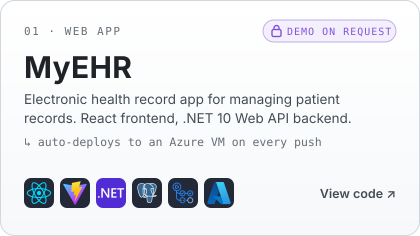
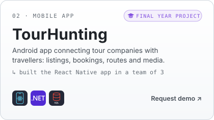
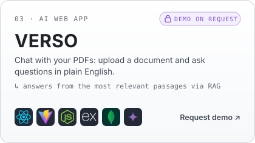
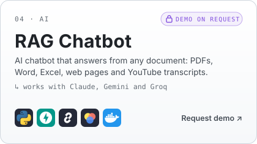

  

  

  
  
  
  

<h2>About Me</h2>

I'm a <b>Full Stack Developer</b> who turns ideas into complete, working products, from web and mobile interfaces to the APIs and databases behind them. Lately most of my work is with <b>AI</b> and <b>LLMs</b>.

<ul>
  <li><b>AI &amp; LLMs:</b> RAG apps with vector search, multi-provider LLM fallback (Claude, Gemini, Groq) and an AI assistant</li>
  <li><b>Web apps:</b> <b>MyEHR</b> with CI/CD to Azure, <b>VERSO</b> (chat with your PDFs) and <a href="https://faisal-muhammad.vercel.app">my portfolio</a></li>
  <li><b>Mobile:</b> <b>TourHunting</b>, my Final Year Project, built with React Native and ASP.NET Core</li>
  <li><b>Backends I build with:</b> .NET / ASP.NET Core, FastAPI and Node.js + Express</li>
  <li><b>Shipping:</b> CI/CD with GitHub Actions, deployments on Azure and Docker containers</li>
  <li><b>Let's connect:</b> <a href="mailto:faisal04github@gmail.com">faisal04github@gmail.com</a> · <a href="https://faisal-muhammad.vercel.app">faisal-muhammad.vercel.app</a></li>
</ul>

<h2>Tech Stack</h2>

<h4>Languages</h4>

<h4>Frontend &amp; Mobile</h4>

<h4>Backend</h4>

<h4>Databases</h4>

<h4>AI &amp; LLMs</h4>

<h4>Tools</h4>

<h2>Featured Projects</h2>

  <a href="https://github.com/faisal-codes04/MyEHR"><picture><source media="(prefers-color-scheme: dark)" srcset="./assets/cards/card-myehr-dark.svg" /></picture></a>
  <a href="mailto:faisal04github@gmail.com?subject=Demo%20request%3A%20TourHunting"><picture><source media="(prefers-color-scheme: dark)" srcset="./assets/cards/card-tourhunting-dark.svg" /></picture></a>

  <a href="mailto:faisal04github@gmail.com?subject=Demo%20request%3A%20VERSO"><picture><source media="(prefers-color-scheme: dark)" srcset="./assets/cards/card-verso-dark.svg" /></picture></a>
  <a href="mailto:faisal04github@gmail.com?subject=Demo%20request%3A%20RAG%20Chatbot"><picture><source media="(prefers-color-scheme: dark)" srcset="./assets/cards/card-ragchatbot-dark.svg" /></picture></a>

<b>More projects</b>

 
<ul>
  <li><b>Patient Management Chatbot</b>: manage hospital patient records through chat in English, Urdu or Hindi, with Claude → Gemini → Groq fallback. <i>React · FastAPI · PostgreSQL</i></li>
  <li><b>AI Personal Assistant</b>: Claude-powered assistant that connects Gmail and social platforms: X, Reddit, Instagram, LinkedIn and TikTok. <i>Python · FastAPI · SQLite</i></li>
  <li><b><a href="https://faisal-muhammad.vercel.app">Portfolio</a></b>: iOS-style liquid glass, a live colour grade that breathes in the background and a 3D sphere of the tools I use. <i>HTML · CSS · JavaScript · Vercel</i></li>
</ul>

🛠️ <b>Currently building:</b> <b>Careloop</b>, a clinic practice-management portal that takes doctors, reception and admins through a full clinic day (ASP.NET Core · C# · PostgreSQL).

<h2>Contribution Activity</h2>

  <picture>
    <source media="(prefers-color-scheme: dark)" srcset="https://raw.githubusercontent.com/faisal-codes04/faisal-codes04/output/github-snake-dark.svg" />
    <source media="(prefers-color-scheme: light)" srcset="https://raw.githubusercontent.com/faisal-codes04/faisal-codes04/output/github-snake.svg" />
    
  </picture>

