  

  

  
  
  
  

<h2>About Me</h2>

I'm a <b>Full Stack Developer</b> who turns ideas into complete, working products, from web and mobile interfaces to the APIs and databases behind them. Lately most of my work is with <b>AI</b> and <b>LLMs</b>.

<ul>
  <li><b>AI &amp; LLMs:</b> RAG apps with vector search, multi-provider LLM fallback (Claude, Gemini, Groq) and an AI assistant</li>
  <li><b>Web apps:</b> <b>MyEHR</b> with CI/CD to Azure, <b>VERSO</b> (chat with your PDFs) and <a href="https://faisal-muhammad.vercel.app">my portfolio</a></li>
  <li><b>Mobile:</b> <b>TourHunting</b>, my Final Year Project, built with React Native and ASP.NET Core</li>
  <li><b>Backends I build with:</b> .NET / ASP.NET Core, FastAPI and Node.js + Express</li>
  <li><b>Shipping:</b> CI/CD with GitHub Actions, deployments on Azure and Docker containers</li>
  <li><b>Let's connect:</b> <a href="mailto:faisal04github@gmail.com">faisal04github@gmail.com</a> · <a href="https://faisal-muhammad.vercel.app">faisal-muhammad.vercel.app</a></li>
</ul>

<h2>Tech Stack</h2>

<h4>Languages</h4>

<h4>Frontend &amp; Mobile</h4>

<h4>Backend</h4>

<h4>Databases</h4>

<h4>AI &amp; LLMs</h4>

<h4>Tools</h4>

<h2>Featured Projects</h2>

<table>
  <tr>
    <td width="50%" valign="top">
      <h3>🏥 <a href="https://github.com/faisal-codes04/MyEHR">MyEHR</a></h3>
      
Electronic health record app for managing patient records. React frontend, .NET 10 Web API backend, auto-deployed to an Azure VM with GitHub Actions.

      
<b>Tech Stack</b>      

      

    </td>
    <td width="50%" valign="top">
      <h3>🧭 TourHunting (FYP)</h3>
      
Android app connecting touring companies with travellers: tour listings, bookings, routes on maps and photo/video galleries.

      
<b>Tech Stack</b>       

      

    </td>
  </tr>
  <tr>
    <td width="50%" valign="top">
      <h3>📖 VERSO</h3>
      
RAG document chat: upload a PDF and ask questions in plain English, answered from the most relevant passages via vector search.

      
<b>Tech Stack</b>      

      

    </td>
    <td width="50%" valign="top">
      <h3>💬 Patient Management Chatbot</h3>
      
Manage hospital patient records through chat in English, Urdu or Hindi, with Claude → Gemini → Groq fallback.

      
<b>Tech Stack</b>        

      

    </td>
  </tr>
  <tr>
    <td width="50%" valign="top">
      <h3>🧠 RAG Chatbot</h3>
      
AI chatbot that answers from any document: PDFs, Word, Excel, web pages and YouTube transcripts.

      
<b>Tech Stack</b>         

      

    </td>
    <td width="50%" valign="top">
      <h3>🤖 AI Personal Assistant</h3>
      
Claude-powered assistant that connects Gmail and social platforms: X, Reddit, Instagram, LinkedIn and TikTok.

      
<b>Tech Stack</b>      

      

    </td>
  </tr>
  <tr>
    <td colspan="2" valign="top">
      <h3>🎨 <a href="https://faisal-muhammad.vercel.app">Portfolio</a></h3>
      
Personal portfolio with iOS-style liquid glass, a live colour grade that breathes in the background and a 3D sphere of the tools I use.

      
<b>Tech Stack</b>     

      

    </td>
  </tr>
</table>

🛠️ <b>Currently building:</b> <b>Careloop</b>, a clinic practice-management portal that takes doctors, reception and admins through a full clinic day (ASP.NET Core · C# · PostgreSQL).

<h2>Contribution Activity</h2>

  <picture>
    <source media="(prefers-color-scheme: dark)" srcset="https://raw.githubusercontent.com/faisal-codes04/faisal-codes04/output/github-snake-dark.svg" />
    <source media="(prefers-color-scheme: light)" srcset="https://raw.githubusercontent.com/faisal-codes04/faisal-codes04/output/github-snake.svg" />
    
  </picture>

